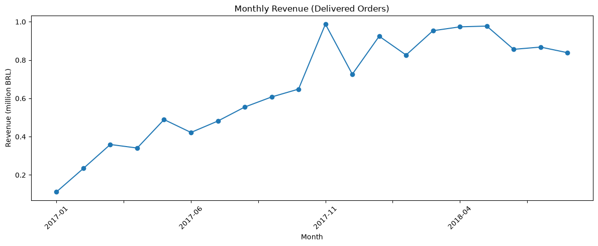
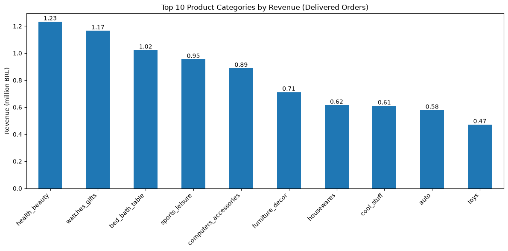
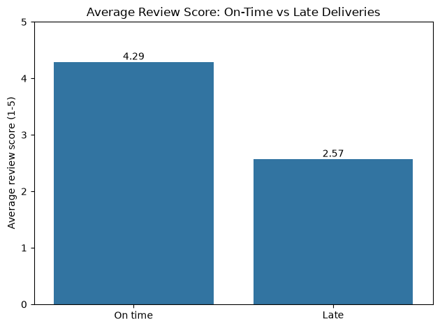
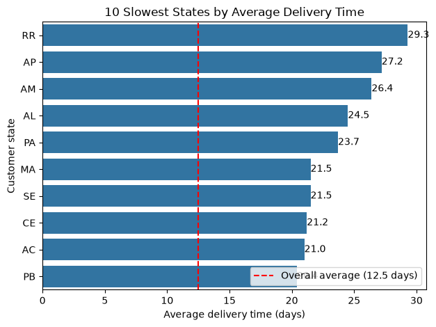
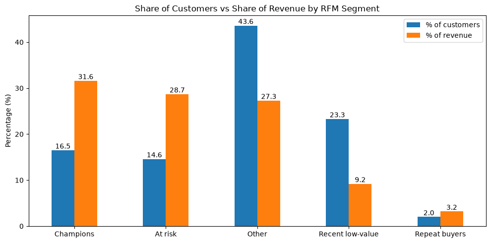

# Olist E-commerce Analysis

An end-to-end analysis of a Brazilian online marketplace using SQL (PostgreSQL) and Python. The project covers sales trends, product categories, customer retention, delivery performance, customer satisfaction, sellers and payments, and it groups customers into segments using RFM analysis.

See [queries.sql](queries.sql) for the SQL work and [analysis.ipynb](analysis.ipynb) for the Python analysis and charts.

## Dataset

- **Source:** [Brazilian E-Commerce Public Dataset by Olist](https://www.kaggle.com/datasets/olistbr/brazilian-ecommerce) (Kaggle)
- **Size:** about 99,000 orders placed between September 2016 and October 2018
- **Tables used:** orders, order_items, payments, reviews, customers, products, sellers, category_translation
- **Currency:** Brazilian real (BRL). Unless stated otherwise, "revenue" means the sum of item prices (freight excluded) on delivered orders.

## Tools

- PostgreSQL for data storage and querying
- Python (pandas, NumPy, matplotlib, seaborn, SQLAlchemy) for analysis and charts
- VS Code and Jupyter Notebook

## Project structure

```
.
├── schema.sql          # CREATE TABLE statements
├── queries.sql         # 16 SQL queries, from basic filters to window functions
├── analysis.ipynb      # Python analysis, charts and RFM segmentation
├── charts/             # Saved chart images
├── requirements.txt    # Python packages
└── README.md
```

## Business questions

1. How do orders and revenue change month by month?
2. Which product categories bring in the most revenue?
3. How many customers come back to buy again?
4. How long does delivery take, and which states are slowest?
5. Do late deliveries hurt customer reviews?
6. Which sellers earn the most revenue?
7. How do customers pay?
8. Which customer groups are most valuable, and which are at risk of leaving?

## SQL techniques used

Joins (inner and left), grouping and filtering with `HAVING`, `CASE WHEN`, date functions, CTEs, window functions (`LAG`, `RANK`, `SUM() OVER`), and conditional aggregation with `FILTER`.

## Key findings

**1. Revenue grew strongly through 2017, then flattened.**
Monthly revenue climbed from about 0.1 million BRL in January 2017 to a peak of about 1.0 million BRL in November 2017, which is consistent with Black Friday. In 2018 it stayed between roughly 0.8 and 1.0 million BRL.

**2. Revenue is spread across a group of leading categories.**
Health & beauty, watches & gifts and bed, bath & table are the top three categories. The top five make up 40.4% of revenue and the top ten make up 63.3%. No single category exceeds 10% of revenue (health & beauty is the highest at 9.45%).

**3. Late delivery is linked to much lower review scores.**
8.1% of delivered orders arrived after the estimated date. Orders delivered on time average a review score of 4.29, while late orders average 2.57, which is 1.72 points (about 40%) lower.

**4. Delivery is slowest in the north and northeast of Brazil.**
The overall average delivery time is 12.5 days. The ten slowest states are all in the north and northeast, with averages between 20.4 and 29.3 days (1.6 to 2.3 times the overall average). The slowest is RR at 29.3 days.

**5. Most customers buy only once.**
About 97% of customers with a delivered order placed a single order, so growth depends heavily on acquiring new customers.

**6. A third of customers bring in about 60% of revenue.**
RFM segmentation (Recency, Frequency, Monetary) of 93,358 customers shows:

| Segment | Customers | % of customers | % of revenue | Average spend (BRL) |
|---|---|---|---|---|
| Champions | 15,389 | 16.5 | 31.6 | 271 |
| At risk | 13,646 | 14.6 | 28.7 | 278 |
| Other | 40,687 | 43.6 | 27.3 | 89 |
| Recent low-value | 21,772 | 23.3 | 9.2 | 56 |
| Repeat buyers | 1,864 | 2.0 | 3.2 | 226 |

Champions and At-risk customers together are 31% of customers and 60% of revenue. The At-risk group (big spenders who have not ordered for a long time) holds about 3.8 million BRL in lifetime spend.

## Charts







## Recommendations

- **Improve delivery estimates and logistics in the north and northeast.** Late orders score much lower, and these states have the longest delivery times.
- **Run a win-back campaign for At-risk customers.** They are high spenders who have not returned.
- **Encourage a second purchase from Recent low-value customers.** They bought recently, so they are the easiest group to turn into repeat buyers.
- **Protect Champions** with loyalty benefits, since they bring in about a third of revenue.

## Data notes and limitations

- The first months of 2016 and the last months of 2018 are incomplete, so they are left out of the revenue trend chart.
- The review analysis shows an association, not proof of cause. Review scores are averaged over reviews, and a few orders have more than one review.
- RFM segment rules are my own definitions. Because about 97% of customers ordered once, frequency separates customers very little, and the segments are driven mostly by recency and spend.
- Revenue uses item prices and excludes freight. "Spend" in the RFM analysis is lifetime spend on delivered orders, not future value.
- Some states have few orders (RR, AP and AC have fewer than 100 delivered orders each), so their average delivery times are less stable. Larger states such as PA, MA and CE show the same pattern.
- Eight orders are marked as delivered but have no delivery date, and they are excluded from delivery-time analysis.

## How to run

1. Install PostgreSQL and create a database named `olist`.
2. Download the dataset from Kaggle and run `schema.sql` to create the tables.
3. Load each CSV file into its table (for example with `\copy` in psql).
4. Run `queries.sql` to reproduce the SQL results.
5. Install the Python packages with `pip install -r requirements.txt`.
6. Open `analysis.ipynb` and run all cells. The first cell asks for your PostgreSQL password.

## Author

Lavnish Kholiya
